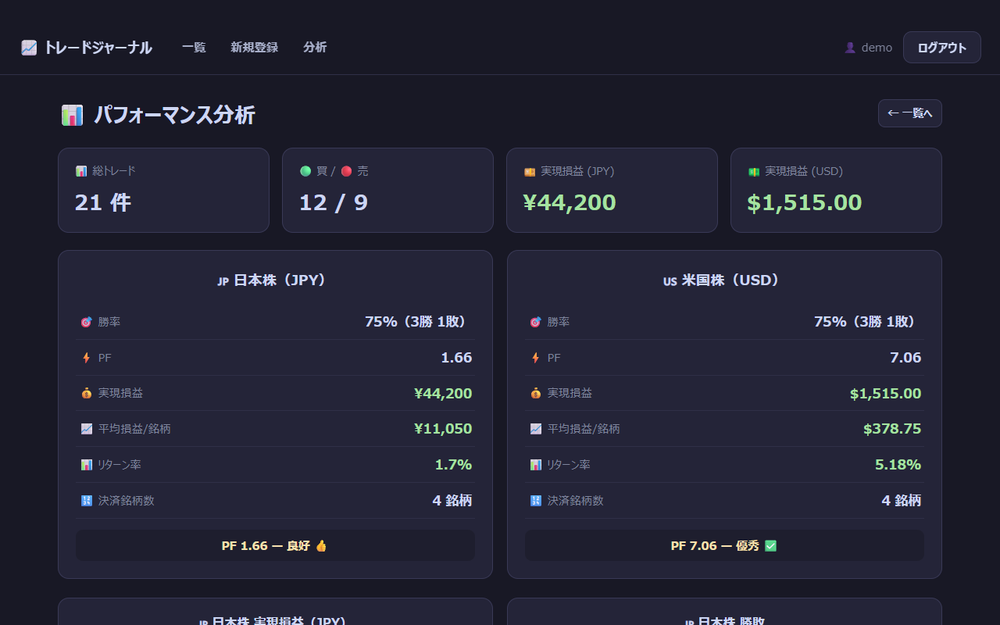
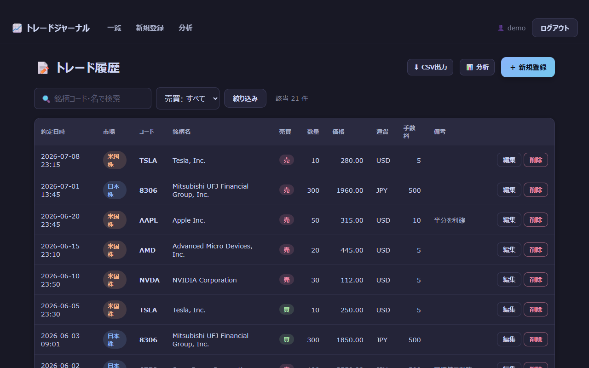
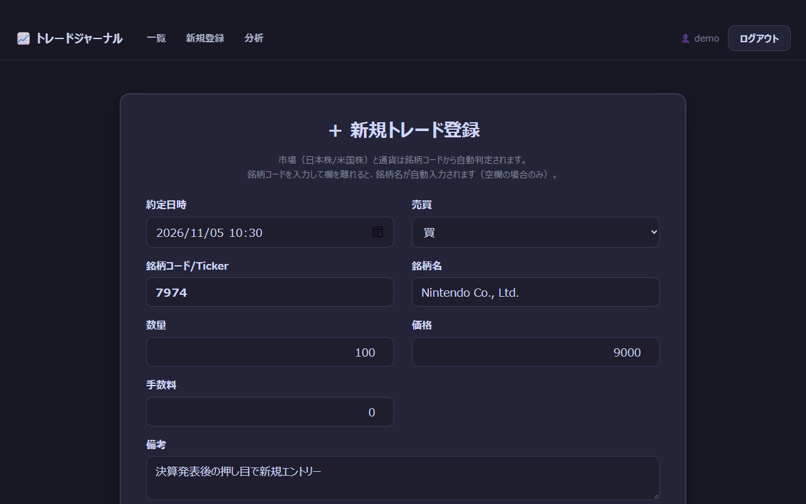
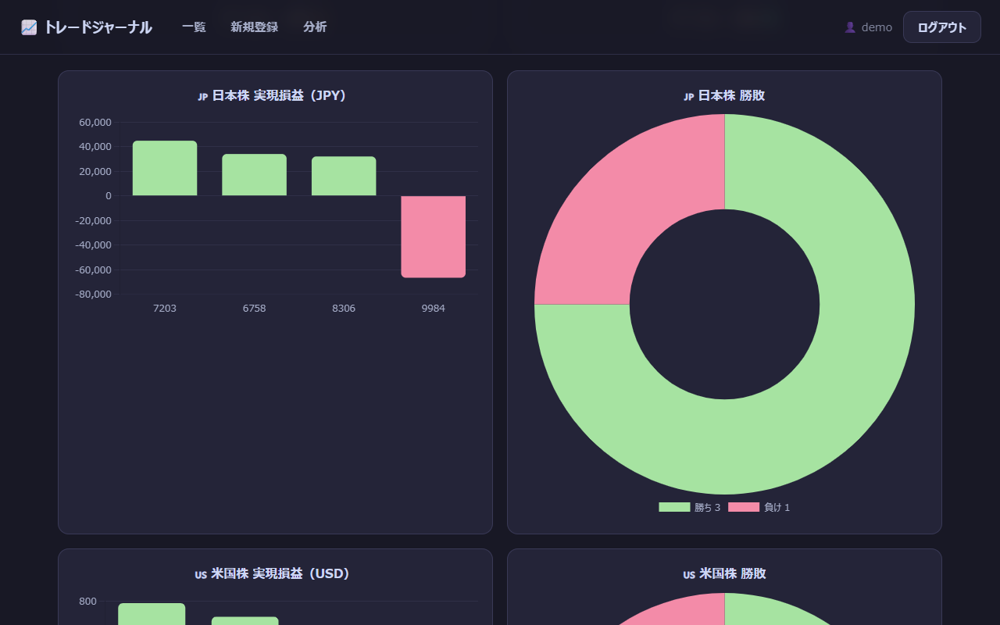

# 株式トレードジャーナル（Trade Journal）

日本株・米国株の売買を記録し、勝率・プロフィットファクター（PF）・実現損益を通貨別（JPY / USD）に振り返るための Django 製 Web アプリです。個人投資家が自分のトレードを見直すためのツールで、ログインしたユーザーごとに記録を分けて管理できます。

[](https://www.python.org/)
[](https://www.djangoproject.com/)


> **English summary:** Trade Journal is a Django web app for recording Japanese and US stock trades and reviewing your results. It detects the market and currency from the ticker, fills in company names from a built-in list or yfinance, and shows win rate, profit factor and realized P&L per currency (JPY / USD) using the moving-average cost method, with Chart.js charts. Login is required, and each user can see only their own trades.

<p align="center"></p>

スクリーンショットの数値は、同梱の `trades.csv` に架空の取引を加えたデモデータです。

## 目次

- [主な機能](#主な機能)
- [クイックスタート](#クイックスタート)
- [使い方](#使い方)
- [技術スタック](#技術スタック)
- [プロジェクト構成](#プロジェクト構成)
- [設計のポイント](#設計のポイント)
- [分析ロジック](#分析ロジック)
- [テスト](#テスト)
- [本番環境で使うとき](#本番環境で使うとき)
- [ロードマップ](#ロードマップ)
- [既知の制限](#既知の制限)
- [データと免責](#データと免責)
- [ライセンス](#ライセンス)

## 主な機能

- **トレードの記録**：約定日時・売買・銘柄コード・銘柄名・数量・価格・手数料・備考を登録し、あとから編集・削除できます。
- **市場と通貨の自動判定**：銘柄コードの形から、日本株（JPY）か米国株（USD）かを判定します（下の表）。小文字で入力しても大文字にそろえます（例：`aapl` → `AAPL`）。
- **銘柄名の自動入力**：内蔵の銘柄辞書（17 銘柄）と yfinance（Yahoo Finance のデータを取得する Python ライブラリ）から会社名を取得して入力します。
- **一覧と検索**：銘柄コード・銘柄名の部分一致検索、売買での絞り込み、20 件ごとのページ送りができます。
- **パフォーマンス分析**：通貨ごとに勝率・PF・実現損益・平均損益・リターン率を集計し、PF を 4 段階で評価します。損益は移動平均法（買うたびに平均取得単価を計算し直す方法）で計算します。
- **グラフと保有状況**：銘柄別の実現損益（棒グラフ）と勝ち負けの数（ドーナツグラフ）を Chart.js で描きます。まだ売っていない株（建玉）の数量と平均取得単価も一覧にします。
- **CSV の取り込みと出力**：管理コマンド `import_trades` で CSV からまとめて登録でき、一覧画面から CSV でダウンロードできます。
- **ログインとデータの分離**：すべての画面でログインが必要です。各ユーザーは自分のトレードだけを表示・変更できます。

### 市場の判定ルール

| 銘柄コードの形         | 市場   | 通貨 | 例     |
| ---------------------- | ------ | ---- | ------ |
| 数字 4 桁              | 日本株 | JPY  | `7203` |
| 数字 3 桁＋英字 1 文字 | 日本株 | JPY  | `130A` |
| 上記以外               | 米国株 | USD  | `AAPL` |

## クイックスタート

前提：Python 3.12 以上（動作確認は Python 3.13）と Git が必要です。Django 6.0 は Python 3.12 以上でしか動きません。

> [!NOTE]
> `requirements.txt` は Tkinter デスクトップ版のときのファイルで、Django が含まれていません。Web 版では使わず、下の手順のとおり Django と yfinance を直接インストールしてください。

### Windows（PowerShell）

```powershell
git clone https://github.com/rebelnaoto7/Trade_Journal.git
cd Trade_Journal
python -m venv .venv
.\.venv\Scripts\Activate.ps1
python -m pip install --upgrade pip
python -m pip install "Django>=6.0,<6.1" yfinance
python manage.py migrate
python manage.py createsuperuser
python manage.py import_trades trades.csv --user demo
python manage.py runserver
```

`Activate.ps1` が「スクリプトの実行が無効」というエラーで止まる場合は、`Set-ExecutionPolicy -Scope Process -ExecutionPolicy Bypass` を実行してから、もう一度実行してください（この設定は、開いている PowerShell の中だけで有効です）。

### macOS / Linux

```bash
git clone https://github.com/rebelnaoto7/Trade_Journal.git
cd Trade_Journal
python3 -m venv .venv
source .venv/bin/activate
python -m pip install --upgrade pip
python -m pip install "Django>=6.0,<6.1" yfinance
python manage.py migrate
python manage.py createsuperuser
python manage.py import_trades trades.csv --user demo
python manage.py runserver
```

### 起動したら

1. `createsuperuser` では、ログインに使うユーザー名とパスワードを決めます（メールアドレスは空欄でかまいません）。上の例は、ユーザー名を `demo` にした場合です。
2. `import_trades` の行は、サンプルデータ（`trades.csv` の 8 件）を登録する任意の手順です。`--user` には、手順 1 で決めたユーザー名を指定してください。
3. ブラウザで http://127.0.0.1:8000/ を開き、手順 1 のユーザーでログインします。
4. yfinance は任意です。入れなくても動きますが、内蔵の辞書にない銘柄は、銘柄名が自動入力されません（手で入力できます）。

## 使い方

### ログインとユーザー

- ログインしていない状態でアクセスすると、ログイン画面（`/accounts/login/`）に移動します。ログインするとトレード一覧が開きます。
- サインアップ（利用者が自分でアカウントを作る）画面はありません。ユーザーを増やすときは、`createsuperuser` を使うか、管理画面（`/admin/`）の「ユーザー」から追加します。
- 画面右上の「ログアウト」でログアウトします。

### トレード一覧

<p align="center"></p>

- 約定日時の新しい順に、20 件ずつ表示します。
- 検索欄で銘柄コード・銘柄名を部分一致で検索し、「売買」のプルダウンで買い・売りを絞り込めます。
- 各行の「編集」で内容を直し、「削除」で確認ダイアログのあと削除します。
- 「CSV出力」で、自分のトレードを `trades_export.csv` としてダウンロードできます（[既知の制限](#既知の制限)も参照）。

### 新規登録と編集

<p align="center"></p>

- 「新規登録」から入力します。約定日時の初期値は現在時刻です。
- 銘柄コードを入力して欄を離れると、銘柄名が空欄のときだけ会社名を取得して入力します。保存するときに銘柄名が空欄なら、そこでも取得を試みます。
- 市場と通貨の入力欄はありません。保存するときに、銘柄コードから決まります。
- 手数料は空欄なら 0 として保存します。数量・価格・手数料にマイナスの値は入力できません。
- 保存すると一覧に戻り、「7974 の買を登録しました。」のようなメッセージが表示されます。

### パフォーマンス分析

<p align="center"></p>

- 上段に、総トレード数、買い・売りの件数、通貨ごとの実現損益を表示します。
- 「日本株（JPY）」「米国株（USD）」のカードに、勝率・PF・実現損益・平均損益/銘柄・リターン率・決済銘柄数と、PF の評価を表示します。
- その下に、銘柄別の実現損益（棒グラフ）と勝ち負けの数（ドーナツグラフ）、保有中の建玉（数量・平均取得単価・取得原価）を表示します。
- 計算方法は「[分析ロジック](#分析ロジック)」を参照してください。

### CSV の取り込み（import_trades）

```text
python manage.py import_trades <CSVファイル> --user <ユーザー名> [--clear]
```

| 引数・オプション | 内容                                                                       |
| ---------------- | -------------------------------------------------------------------------- |
| `<CSVファイル>`  | 取り込む CSV ファイルのパス（必須）                                        |
| `--user`         | 登録先のユーザー名（必須）。存在しないユーザーを指定するとエラーになります |
| `--clear`        | 取り込む前に、そのユーザーのトレードをすべて削除します                     |

CSV は UTF-8（BOM の有無はどちらでも可）で、1 行目に次の見出しを付けます。

```text
日付,市場,銘柄コード/Ticker,銘柄名,売買,数量,価格,通貨,手数料,備考
2026-04-18,日本株,7203,Toyota Motor Corporation,買,100,4000,JPY,1000,
2026/04/20 09:30,,AAPL,,買,10,299,,10,市場・通貨・銘柄名は空欄でも可
```

- 日付は `YYYY-MM-DD`、`YYYY-MM-DD HH:MM`、`YYYY-MM-DDTHH:MM` の形式です（区切りは `/` でも可）。時刻を省くと 0:00（日本時間）になります。
- 市場・通貨・銘柄名が空欄のときは、銘柄コードから補います。銘柄コードが空の行は読み飛ばします。
- 売買には「買」か「売」を入れます。取り込みでは画面の入力のような値の検証をしないため、それ以外の売買やマイナスの数量もそのまま登録されます。
- 途中の行でエラーになると、そのファイルの取り込みはすべて取り消されます。
- 同じファイルを 2 回取り込むと、同じトレードが重複して登録されます。入れ直すときは `--clear` を付けてください。

### URL 一覧

| URL                                | 内容                                       | URL 名           |
| ---------------------------------- | ------------------------------------------ | ---------------- |
| `/`                                | トレード一覧（検索・絞り込み・ページ送り） | `trade_list`     |
| `/add/`                            | 新規登録                                   | `trade_create`   |
| `/<id>/edit/`                      | 編集                                       | `trade_edit`     |
| `/<id>/delete/`                    | 削除（POST のみ。GET では一覧に戻ります）  | `trade_delete`   |
| `/analysis/`                       | パフォーマンス分析                         | `analysis`       |
| `/export/`                         | CSV 出力（`trades_export.csv`）            | `export_csv`     |
| `/api/lookup/?ticker=<銘柄コード>` | 市場・通貨・銘柄名を JSON で返す API       | `lookup_company` |
| `/accounts/login/`                 | ログイン                                   | `login`          |
| `/accounts/logout/`                | ログアウト（POST）                         | `logout`         |
| `/admin/`                          | Django 管理画面（スタッフユーザーのみ）    | —                |

アプリの画面と API は、すべてログインが必要です。`/api/lookup/?ticker=7203` の応答は次のとおりです（`\u65e5\u672c\u682a` は「日本株」をエスケープした文字列です）。

```json
{"ticker": "7203", "name": "Toyota Motor Corporation", "market": "\u65e5\u672c\u682a", "currency": "JPY"}
```

## 技術スタック

| 分類               | 使用技術                                                                        |
| ------------------ | ------------------------------------------------------------------------------- |
| 言語               | Python 3.13                                                                     |
| Web フレームワーク | Django 6.0（認証・管理画面・ORM・テンプレート）                                 |
| データベース       | SQLite（Django の初期設定のまま。`migrate` で `db.sqlite3` を作成）             |
| グラフ             | Chart.js 4.4.1（`tracker/static/` に同梱。CDN は使いません）                    |
| 銘柄名の取得       | 内蔵の銘柄辞書と yfinance（任意。取得結果は Django のキャッシュに保存）         |
| 画面               | Django テンプレート、自作 CSS（ダークテーマ）、JavaScript（フレームワークなし） |
| テスト             | Django のテストフレームワーク（`django.test.TestCase`）                         |

## プロジェクト構成

```text
Trade_Journal/
├── manage.py
├── trades.csv                    # サンプルデータ（8 件）
├── tradejournal/                 # プロジェクト設定
│   ├── settings.py               # 言語 ja、タイムゾーン Asia/Tokyo、ログイン後の移動先など
│   ├── urls.py                   # /admin/、/accounts/、アプリの URL をまとめる
│   ├── asgi.py
│   └── wsgi.py
├── tracker/                      # アプリ本体
│   ├── models.py                 # Trade モデル（ユーザーごとのトレード）
│   ├── forms.py                  # 登録・編集フォーム
│   ├── views.py                  # 一覧・登録・編集・削除・分析・CSV 出力・銘柄名 API
│   ├── urls.py
│   ├── services.py               # 市場の判定と銘柄名の取得（辞書 → キャッシュ → yfinance）
│   ├── analytics.py              # 損益の集計（移動平均法）
│   ├── admin.py                  # 管理画面の設定
│   ├── tests.py                  # テスト（11 件）
│   ├── management/commands/
│   │   └── import_trades.py      # CSV 取り込みコマンド
│   ├── migrations/
│   ├── static/tracker/
│   │   ├── css/app.css           # 画面のスタイル
│   │   └── js/chart.umd.min.js   # Chart.js 4.4.1
│   └── templates/
│       ├── registration/login.html
│       └── tracker/              # base / trade_list / trade_form / analysis
├── docs/                         # スクリーンショットと開発メモ
└── （旧版・未使用のファイル）    # 下の補足を参照
```

このアプリは、Tkinter で作ったデスクトップ版を Django に移植したもので、リポジトリには旧版のファイルも残っています。

- `requirements.txt` は Tkinter 版の依存関係（tkcalendar、matplotlib など）です。Web 版では使いません。
- `trade_journal_web.html` は、サーバーなしでブラウザだけで動く試作版です。CSV を読み込んで集計できますが、損益は旧方式（銘柄ごとに、売りの合計から買いの合計を引く）で計算し、Chart.js をインターネット（CDN）から読み込みます。
- 次のファイルは、Web アプリの実行には使われていません：`tracker/utils.py`、`tracker/fix_analysis.py`、`tracker/fix_css.py`、`tracker/templates/tracker/preview_form.html`、`Trade_Journal.pyproj`、`Trade_Journal.slnx`、`azure-pipelines.yml`。

開発の経緯、移植時のトラブル記録、既知の不具合は [docs/DEVELOPMENT.md](docs/DEVELOPMENT.md) にまとめています。

## 設計のポイント

- **ユーザーごとのデータ分離**：一覧・分析・CSV 出力は `Trade.objects.filter(user=request.user)` で自分のトレードだけを読み、編集・削除は `get_object_or_404(Trade, pk=pk, user=request.user)` で取り出します。他のユーザーのトレードの ID を指定しても 404 になります。
- **市場判定と銘柄名の取得を 1 か所に集約**：`tracker/services.py` の `resolve_trade_fields()` を、登録・編集・CSV 取り込みで共通に使います。銘柄名の API も同じファイルの関数を使います。
- **外部 API に頼りすぎない**：銘柄名は、内蔵の辞書 → キャッシュ → yfinance の順に探します。東証の銘柄はコードに `.T` を付けて問い合わせます。取得できた名前は 24 時間、失敗は 5 分キャッシュし、yfinance がなくてもエラーにせず空欄にします。
- **集計は pandas を使わない Python だけの処理**：`tracker/analytics.py` が銘柄ごとに移動平均法で損益を計算し、結果を辞書で返します。
- **グラフ用データは `json_script` で渡す**：集計結果をページに JSON として埋め込み、ブラウザ側で Chart.js が描きます。`json.dumps` と重ねると二重にエンコードされるため、辞書をそのまま渡しています。
- **金額は `DecimalField`**：数量・価格・手数料は 0 以上に制限しています。集計結果は小数第 2 位で丸めます。
- **データを変える操作は POST**：削除とログアウトは、CSRF トークン付きの POST で行います。

## 分析ロジック

`tracker/analytics.py` の `calculate_stats()` の計算方法です。トレードを銘柄ごとにまとめ、約定日時の古い順（同じ日時なら登録順）に処理します。

### 銘柄ごとの損益（移動平均法）

```text
買い：取得原価 += 数量 × 価格 + 手数料
      保有数量 += 数量

売り：平均取得単価 = 取得原価 ÷ 保有数量
      実現損益 += (売却数量 × 売却価格 − 手数料) − 平均取得単価 × 売却数量
      取得原価と保有数量から、売った分を差し引く
```

- 手数料は、買いでは取得原価に含め、売りでは売却額から差し引きます。
- 売りが 1 回以上ある銘柄を「決済銘柄」として集計します。一部だけ売った銘柄は、売った分の損益が集計に入り、残りは「保有中の建玉」に表示されます。
- 保有数量を超えて売った分（買いの記録がない売りを含む）は、売却代金をそのまま利益として扱います。空売りには対応していません。

### 通貨ごとの指標

日本株（JPY）と米国株（USD）は別々に集計します（為替換算はしません）。

| 指標                         | 計算方法                                                                            |
| ---------------------------- | ----------------------------------------------------------------------------------- |
| 勝率                         | 利益が出た決済銘柄の数 ÷ 決済銘柄の数 × 100                                         |
| PF（プロフィットファクター） | 利益が出た銘柄の損益の合計 ÷ 損失が出た銘柄の損益の合計の絶対値（損失がなければ ∞） |
| 実現損益                     | 決済銘柄の実現損益の合計                                                            |
| 平均損益/銘柄                | 実現損益 ÷ 決済銘柄の数                                                             |
| リターン率                   | 実現損益 ÷ 売った分の取得原価の合計 × 100                                           |
| 決済銘柄数                   | 売りが 1 回以上ある銘柄の数                                                         |

- 勝ち負けは、トレード 1 回ごとではなく、銘柄ごとの損益の合計で数えます。損益がちょうど 0 の銘柄は勝ちにも負けにも数えませんが、勝率の分母には入ります。
- PF の評価は、2.0 以上が「優秀」、1.5 以上が「良好」、1.0 以上が「分岐点以上」、1.0 未満が「改善が必要」です。損失の銘柄がないときは、PF を「∞」、評価を「損失なし」と表示します。
- 上段の総トレード数と買い・売りの件数は、通貨に関係なくすべてのトレードを数えます。

### 計算例（trades.csv の 7203）

| 約定日     | 売買 | 数量 × 価格 | 手数料 | 計算                                         |
| ---------- | ---- | ----------- | ------ | -------------------------------------------- |
| 2026-04-18 | 買   | 100 × 4,000 | 1,000  | 取得原価 401,000 円（平均取得単価 4,010 円） |
| 2026-04-18 | 売   | 100 × 4,500 | 1,000  | (450,000 − 1,000) − 401,000 = **+48,000 円** |
| 2026-04-20 | 買   | 100 × 3,392 | 1,000  | 取得原価 340,200 円（平均取得単価 3,402 円） |
| 2026-04-20 | 売   | 100 × 3,380 | 1,000  | (338,000 − 1,000) − 340,200 = **−3,200 円**  |

7203 の実現損益は 48,000 − 3,200 = 44,800 円、リターン率は 44,800 ÷ (401,000 + 340,200) × 100 ≒ 6.04% です。

`trades.csv` だけを取り込んだ場合、売りがあるのは 7203 だけなので、日本株のカードは「勝率 100%（1勝 0敗）、PF ∞、実現損益 ¥44,800、リターン率 6.04%」、米国株のカードは「決済済みトレードなし」になります。保有中の建玉には、6920（200 株）、2222（100 株）、AAPL（100 株）が表示されます。

## テスト

```bash
python manage.py test
```

実行結果（Windows 11 / Python 3.13.15 / Django 6.0.9）：

```text
Found 11 test(s).
Creating test database for alias 'default'...
System check identified no issues (0 silenced).
...........
----------------------------------------------------------------------
Ran 11 tests in 1.636s

OK
Destroying test database for alias 'default'...
```

| テストクラス        | 件数 | 確かめていること                                                                                               |
| ------------------- | ---- | -------------------------------------------------------------------------------------------------------------- |
| `DetectMarketTests` | 4    | 市場の判定（数字 4 桁、数字 3 桁＋英字、米国株）と、銘柄コードの正規化（空白の除去・大文字化）                 |
| `AnalyticsTests`    | 5    | 移動平均法の実現損益（上の計算例と同じ 44,800 円）、売っていない銘柄の扱い、一部売却、通貨別の集計、データなし |
| `ViewSecurityTests` | 2    | 未ログイン時のリダイレクトと、他のユーザーのトレードを削除できないこと（404）                                  |

画面の動作は、2026 年 11 月に Windows 11 / Python 3.13.15 / Django 6.0.9 / yfinance 1.7.0 で、次のように手動で確認しました。

- クイックスタートの手順（`migrate`、`createsuperuser`、`import_trades trades.csv --user demo` で 8 件登録、`runserver`）
- `python manage.py check` で問題がないこと、`python manage.py makemigrations --check --dry-run` でモデルとマイグレーションの差分がないこと
- 各画面が HTTP 200 で表示され、未ログインではログイン画面に 302 でリダイレクトされること
- 登録・編集・削除、検索・絞り込み、CSV 出力、分析画面の数値とグラフの表示（数値は上の計算方法と一致）
- yfinance での銘柄名の取得（例：`7974` → Nintendo Co., Ltd.、`130A` → Veritas In Silico Inc.）。存在しないコードでは空欄になり、エラーにならないこと

## 本番環境で使うとき

`tradejournal/settings.py` は開発用の設定のままです。インターネットに公開する前に、少なくとも次の点を変更してください。今の `settings.py` は環境変数を読まないため、読み込む処理の追加も必要です。

| 項目            | 現在の設定                       | 本番での対応                                                                          |
| --------------- | -------------------------------- | ------------------------------------------------------------------------------------- |
| `SECRET_KEY`    | 開発用の値を直接記述（公開済み） | 新しい値を作り、環境変数などから読み込む                                              |
| `DEBUG`         | `True`                           | `False` にする                                                                        |
| `ALLOWED_HOSTS` | `[]`                             | 公開するホスト名を設定する                                                            |
| データベース    | SQLite（`db.sqlite3`）           | PostgreSQL などに切り替える                                                           |
| 静的ファイル    | `STATIC_ROOT` が未設定           | `STATIC_ROOT` を設定して `collectstatic` し、Web サーバーや WhiteNoise で配信する     |
| アプリの起動    | `runserver`（開発用）            | Gunicorn などの WSGI サーバーで `tradejournal.wsgi:application` を動かす              |
| HTTPS           | 設定なし                         | `SECURE_SSL_REDIRECT`、`SESSION_COOKIE_SECURE`、`CSRF_COOKIE_SECURE`、HSTS を設定する |

新しい `SECRET_KEY` は次のコマンドで作れます。足りない設定は `python manage.py check --deploy` で確認できます（今の設定では 7 件の警告が出ます）。

```bash
python -c "from django.core.management.utils import get_random_secret_key; print(get_random_secret_key())"
```

- コンテナ型の PaaS など、再起動や再デプロイでファイルが消える環境では、SQLite のデータも消えてしまいます。そうした環境では、外部のデータベースを使ってください。
- yfinance の取得結果は、プロセスごとのメモリ（Django の初期設定のキャッシュ）に保存されます。複数のプロセスで動かすときは、Redis などの共有キャッシュも検討してください。

## ロードマップ

- [x] Chart.js をアプリに同梱（CDN なしで動作）
- [x] CSV 出力
- [ ] Excel 形式での出力
- [ ] PostgreSQL への対応
- [ ] クラウドへのデプロイ（WhiteNoise による静的ファイル配信など）
- [ ] yfinance 呼び出しの非同期化、または公式 API への置き換え
- [ ] 為替レートを使った、円とドルを合わせた損益
- [ ] 月次・年次の損益推移とドローダウンのグラフ

## 既知の制限

- **損益計算の簡略化**：空売りや株式分割には対応していません。保有数量を超える売りは、超えた分の売却代金がそのまま利益になります。
- **勝ち負けは銘柄単位**：同じ銘柄の売買を何度繰り返しても、合計の損益で 1 勝または 1 敗と数えます。
- **通貨は別々に集計**：円とドルを合わせた損益は出しません（為替換算なし）。
- **対応市場**：判定するのは日本株と米国株だけです。それ以外の銘柄コードは、米国株（USD）として扱います。
- **yfinance**：Yahoo Finance の非公式なデータ取得ライブラリのため、アクセス制限や仕様変更、ネットワークの状態によって取得できないことがあります。最初の問い合わせには数秒かかることがあります（確認時は約 6 秒）。取得できないときは、銘柄名を手で入力してください。
- **CSV 出力**：日時が UTC（日本時間の 9 時間前）で出力されます。また、各行の先頭に BOM（U+FEFF）が付くため、出力したファイルはそのままでは `import_trades` で取り込めません。
- **CSV 取り込み**：値のチェックや重複の検出をしません（「[CSV の取り込み](#csv-の取り込みimport_trades)」を参照）。
- **ユーザー登録**：サインアップ画面がないため、ユーザーは管理者が作成します。
- **サンプルデータ**：`trades.csv` は動作確認用のデータで、同じ条件の買いが 2 回ある銘柄（6920）なども含みます。自分の記録だけで分析したいときは、サンプルを取り込まないか、画面から削除するか、`--clear` を付けて自分の CSV を取り込み直してください。
- **画面の表示**：一部のテンプレートが BOM 付きで保存されているため、一覧・登録・分析画面ではナビゲーションの上に余白が出ます。登録画面の「キャンセル」と、分析画面（データなし）の「トレードを登録」はリンクになっておらず、URL と文字がそのまま表示されます。編集画面の見出しは「新規トレード登録」のままです。

## データと免責

- 銘柄名は、内蔵の辞書か、yfinance を通じて Yahoo Finance から取得します。yfinance は Yahoo とは関係のないオープンソースのツールです。取得したデータの利用条件は、Yahoo の利用規約を確認してください。
- 株価の取得や時価評価はしません。損益は、入力した約定価格と手数料だけから計算します。
- 計算は簡略化しているため、証券会社の報告書や税務上の計算（取得費の計算方法、税金、配当など）とは一致しないことがあります。
- このアプリは記録と振り返りのためのツールで、投資助言ではありません。投資の判断はご自身の責任で行ってください。

## ライセンス

MIT
